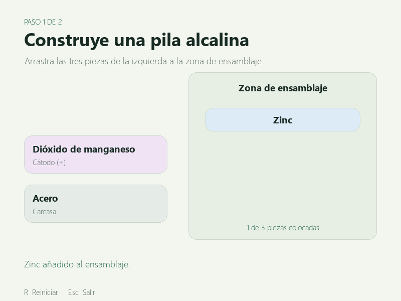

# El ciclo de la pila

Minijuego educativo en español sobre el ensamblaje de una pila alcalina y la entrega de pilas usadas. El reto tiene dos etapas y se juega con el ratón.



## Cómo jugar

1. **Ensamblaje.** Arrastra el zinc, el dióxido de manganeso y la carcasa de acero a la zona de ensamblaje, en el orden que prefieras. El contador muestra las piezas colocadas. Cuando aparezca la pila completa, pulsa **Continuar** o presiona **Enter**.
2. **Recolección.** Elige entre tres canecas de residuos domésticos y un punto de recolección de pilas usadas. El juego explica el resultado y permite empezar otra partida.

Pulsa **R** para reiniciar en cualquier momento o **Esc** para salir.

## Ejecutar en Windows

Necesitas Python 3.11 a 3.14. Abre PowerShell en la carpeta del proyecto y ejecuta:

```powershell
python -m venv .venv
.\.venv\Scripts\python.exe -m pip install -r requirements.txt
.\.venv\Scripts\python.exe proyecto_pilas.py
```

El proyecto usa [pygame-ce](https://pypi.org/project/pygame-ce/2.5.8/) como dependencia y lo importa en el código con el nombre `pygame`.

## Generar un ejecutable

Desde la misma carpeta y con las dependencias ya instaladas:

```powershell
.\.venv\Scripts\python.exe -m pip install pyinstaller
.\.venv\Scripts\python.exe -m PyInstaller --noconfirm proyecto_pilas.spec
```

El ejecutable queda en `dist\proyecto_pilas.exe`. La configuración de PyInstaller incluye las imágenes que el juego carga durante la partida.

## Cómo funciona

- `proyecto_pilas.py` gestiona las tres pantallas (ensamblaje, elección y resultado), el arrastre con el botón izquierdo y la respuesta a cada decisión.
- `requirements.txt` fija la versión de la dependencia del juego.
- `proyecto_pilas.spec` configura la compilación y toma del código la lista de ilustraciones necesarias.
- Las imágenes de la partida se cargan junto al código y el repositorio también conserva las ilustraciones originales del proyecto.

## Qué enseña

En una pila alcalina, el zinc forma el ánodo, el dióxido de manganeso forma el cátodo y el acero sirve de carcasa. El ensamblaje virtual presenta estos tres componentes como un modelo simplificado. [Manual técnico de pilas alcalinas de Energizer](https://energizer.com/wp-content/uploads/2024/05/alkaline_appman.pdf).

En Colombia, las pilas usadas se entregan en puntos de recolección de programas posconsumo. Busca un contenedor identificado para pilas usadas. [Ministerio de Ambiente y Desarrollo Sostenible](https://www.minambiente.gov.co/asuntos-ambientales-sectorial-y-urbana/pilas-y-acumuladores/).
